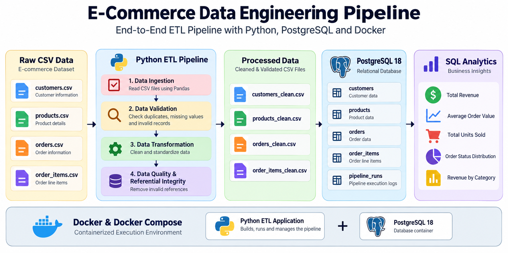

<<<<<<< HEAD
# E-Commerce Data Engineering Pipeline

A Dockerized ETL pipeline that ingests e-commerce data, validates and transforms it using Python/Pandas, loads it into PostgreSQL, and generates SQL-based analytics.

## Tech Stack

- Python
- Pandas
- SQL
- PostgreSQL
- SQLAlchemy
- FastAPI
- Docker & Docker Compose

## Architecture


Raw CSV → Validation → Transformation → Data Quality → PostgreSQL → SQL Analytics

## Features

- Automated CSV data ingestion
- Data validation and cleaning
- Duplicate and invalid record handling
- Referential integrity checks
- PostgreSQL database loading
- SQL analytics and business metrics
- Pipeline execution tracking
- Logging and error handling
- Dockerized environment
- Full refresh, incremental, and upsert pipeline modes

## Project Structure

```text
ecommerce-data-pipeline/
├── data/
│   ├── raw/
│   └── processed/
├── sql/
│   ├── 01_schema.sql
│   └── 02_analytics.sql
├── src/
│   ├── pipeline.py
│   ├── generate_data.py
│   ├── validate.py
│   ├── transform.py
│   ├── load.py
│   ├── analytics.py
│   ├── database.py
│   └── run_tracker.py
├── Dockerfile
├── docker-compose.yml
├── requirements.txt
└── README.md

Run with Docker

Create a .env file:

DB_PASSWORD=your_postgres_password

Then run:

docker compose up --build

The pipeline will automatically:

Start PostgreSQL
Generate/load data
Validate and transform records
Load cleaned data into PostgreSQL
Run SQL analytics
Track pipeline execution

Results

100 customers loaded
29 products loaded
500 orders loaded
960 valid order items loaded
1,589 total records processed
Revenue and order analytics generated

Key Engineering Concepts

ETL Pipeline Design
Data Quality & Validation
Relational Database Design
Referential Integrity
SQL Analytics
Docker Containerization
Pipeline Monitoring
Author

Aryan Gehlawat
B.Tech Computer Science & Engineering — 2026
=======
# ecommerce-data-pipeline
Dockerized ETL pipeline using Python, Pandas, PostgreSQL and SQL analytics.
>>>>>>> 9c862a08e6303e3f5a238008e8aac4a17c3a774a
